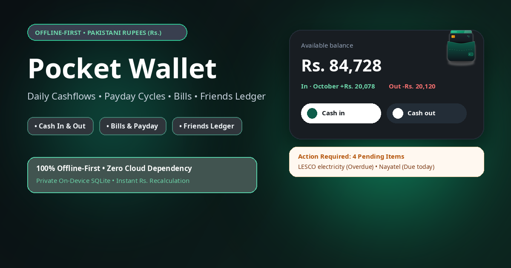

<p align="center">
  
</p>

<p align="center">
  
  
  
  
  
</p>

<h3 align="center">Smart Cashflow Management, Recurring Bills & Giving Ledger</h3>

<p align="center">
  <b>Pocket Wallet</b> is an ultra-sleek, offline-first personal finance application engineered for speed, privacy, and visual elegance. Designed to bridge everyday cash transactions, recurring bill cycles, and bilateral debt ledgers into a unified, pitch-black financial command center.
</p>

---

## ✨ Features at a Glance

### 💳 1. Central Wallet & Real-time Cashflow
- **Instant Inflow & Outflow Logging**: Add transactions in seconds with smart category presets (Food, Rent, Fuel, Freelance, Shopping, etc.).
- **Live Cashflow Filtering**: Segment transactions instantly by *All*, *Inflows*, or *Outflows*.
- **Bidirectional Balance Sync**: Central wallet balance dynamically adapts when transactions are added, refunded, settled, or rolled back.
- **Privacy Mode**: One-tap toggle to mask balance figures in public spaces.

### 📅 2. Recurring Bills & Salary Tracker
- **Smart Due Date Cycles**: Support for Monthly, Weekly, Quarterly, Yearly, and Custom-day cycle cadences.
- **Cycle Auto-Advancement**: Advance recurring bills to their next cycle while preserving transaction audit history.
- **Salary Automation Guard**: Monthly payday credit with protection against accidental double-deposits in the same calendar month.
- **Local Push Notifications**: Scheduled reminders trigger right at 9:00 AM on due dates without requiring external servers.

### 🤝 3. Friends Ledger (Give & Take)
- **Bilateral Ledger Tracking**: Keep track of money lent to or borrowed from friends and colleagues.
- **Partial & Full Settlements**: Settle balances in increments with comprehensive repayment records and notes.
- **Ground-Truth Recalculations**: Accurately recomputes net positions, total lent, and total borrowed to eliminate balance drift.
- **Overdue Detection**: Timezone-safe date normalization automatically highlights delinquent recoveries.
- **Contact Management**: Search, filter, inspect history, or remove settled contacts.

### 🔐 4. Dual-Layer Biometric Security
- **Dual Authentication**: Secure access via 4-digit PIN, Fingerprint, or Face ID.
- **Hardware-Aware Display**: Biometric options automatically adapt based on device hardware support.
- **Background Privacy Shield**: App automatically locks whenever sent to the background or switched away.
- **Self-Contained Reset**: Full data purge option that clears storage, cancels active notifications, and resets authentication.

### 📴 5. Offline-First Architecture
- **Zero Cloud Dependence**: 100% of your transaction history and personal data stays on your local device via encrypted AsyncStorage.
- **Instant Launch & Responsiveness**: Zero network latency, instant startup splash, and offline data mutations.

---

## 🎨 Design Philosophy & UI/UX

Pocket Wallet is built with a bespoke **pitch-black glassmorphic design system**:
- **Palette**: Deep void blacks (`#000000`, `#0A0E12`) paired with crisp typography (`#FFFFFF`) and muted secondary slate accents (`#64748B`, `#8E9AA6`).
- **Tactile Inputs**: Custom modal sheets with adaptive `KeyboardAvoidingView` configurations that guarantee inputs never get obstructed.
- **Custom Modals**: Destructive workflows use customized, branded confirmation modals matching the app's aesthetic rather than generic native alerts.

---

## 🏗️ Project Architecture

```plaintext
pocket-wallet/
├── assets/                  # High-res logos, adaptive icons, and promotional banners
│   ├── banners/             # App Store and social share assets
│   └── logos/               # Light/dark mode vector-optimized marks
├── src/
│   ├── components/          # Modular UI components (Modals, Rows, Cards)
│   │   ├── ActionRequiredCard.tsx  # Dynamic dashboard alert cards
│   │   ├── BalanceCard.tsx         # Central wallet balance showcase
│   │   ├── ConfirmModal.tsx        # Branded action confirmation dialog
│   │   ├── FriendDetailModal.tsx   # Detailed ledger and settlement view
│   │   ├── QuickEntryModal.tsx     # Fast cash-in / cash-out bottom sheet
│   │   └── ...
│   ├── context/
│   │   └── WalletContext.tsx       # Global state machine & bidirectional sync engine
│   ├── screens/             # Primary route views
│   │   ├── HomeScreen.tsx          # Real-time cashflow dashboard
│   │   ├── BillsSalaryScreen.tsx   # Bills manager and salary engine
│   │   ├── FriendsLedgerScreen.tsx # Give & take ledger
│   │   ├── ProfileScreen.tsx       # User profile & security controls
│   │   └── AboutScreen.tsx         # App info, build metadata & release notes
│   ├── services/
│   │   ├── notifications.ts        # Expo local notifications scheduler (9 AM triggers)
│   │   └── storage.ts              # Robust AsyncStorage persistence layer
│   ├── theme/               # Central design tokens and color definitions
│   └── types/               # Strict TypeScript models and interfaces
├── app.json                 # Expo project configuration & plugins
├── eas.json                 # EAS build profiles (APK, Production, Development)
├── package.json             # Dependencies and build scripts
└── tsconfig.json            # Strict TypeScript configuration
```

---

## 🚀 Getting Started

### Prerequisites
- Node.js (v18.0.0 or later)
- npm, yarn, or bun
- Expo Go app on your physical device, or an Android/iOS emulator

### Installation

1. **Clone the repository**:
   ```bash
   git clone https://github.com/mzeeshanyousaf/pocket-wallet.git
   cd pocket-wallet
   ```

2. **Install dependencies**:
   ```bash
   npm install
   ```

3. **Start the development server**:
   ```bash
   npx expo start
   ```

4. **Run on target platform**:
   - Press <kbd>a</kbd> for Android Emulator / Device
   - Press <kbd>i</kbd> for iOS Simulator
   - Scan the QR code using the **Expo Go** app

---

## 📦 Building Standalone APK (EAS)

Pocket Wallet is pre-configured with Expo Application Services (EAS) for cloud compilation.

### Generate Standalone Distribution APK (Android)
```bash
npx eas-cli build -p android --profile preview
```

### Generate Production App Bundle (Google Play Store)
```bash
npx eas-cli build -p android --profile production
```

---

## 🧪 Quality & Verification

Ensure type safety and clean code formatting before submitting changes:

```bash
# Typecheck TypeScript codebase
npx tsc --noEmit

# Run ESLint validation
npx expo lint

# Diagnose Expo dependencies
npx expo-doctor
```

---

## 🔒 Security & Privacy

- **Local Storage Only**: No external analytics, third-party tracking, or cloud databases are bundled with this application.
- **Biometric Security**: Leverages native Android `BiometricPrompt` and iOS `LocalAuthentication` APIs.
- **Automatic Session Timeout**: Active sessions lock upon application pause or system multitasking.

---

## 📄 License

This project is licensed under the [MIT License](LICENSE) — free for personal and commercial exploration.
